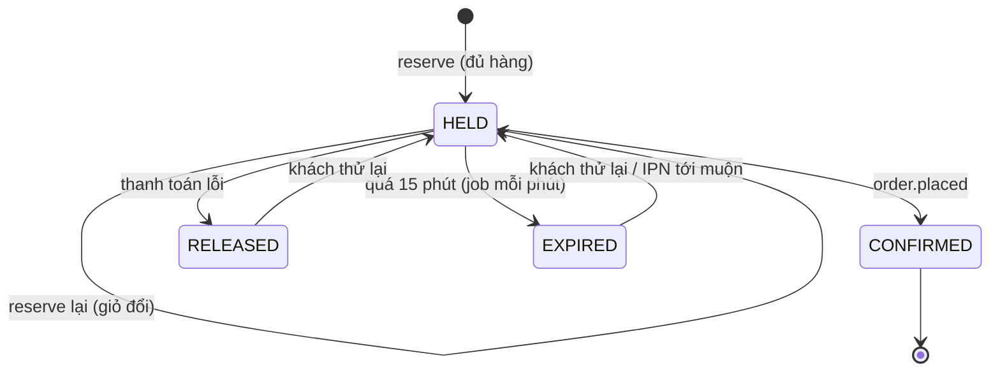
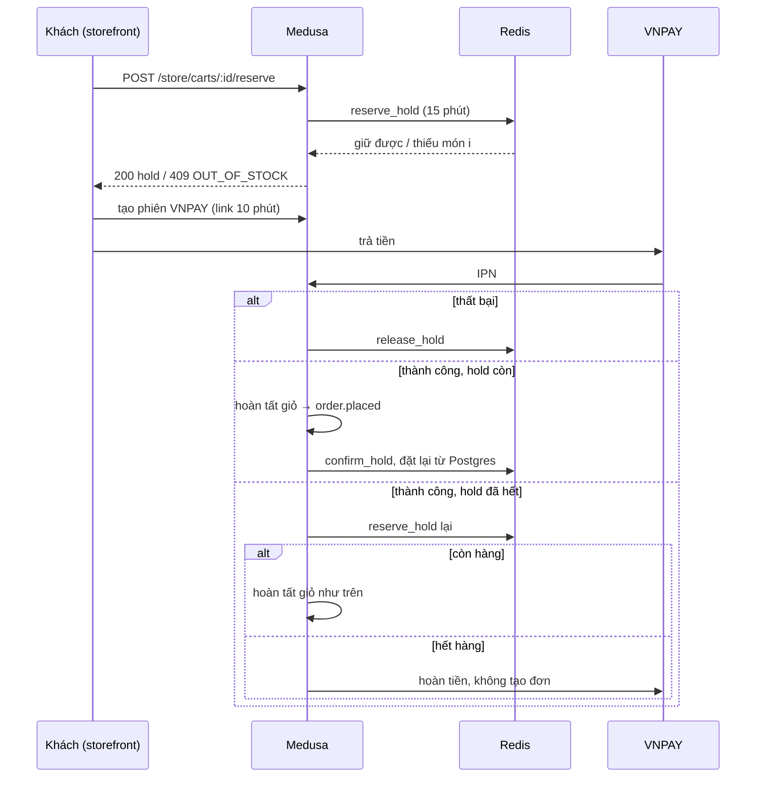

# Hot-stock: giữ hàng bằng Redis trước khi thanh toán

> **DÀN Ý.** File này chỉ có ý chính, bảng và sơ đồ để nhóm issue #9 (noper1080, Thiện) tự viết thành văn xuôi bằng lời của mình (tiêu chí của issue #9; quy định AI score < 10% khi đưa vào báo cáo). Đừng chép nguyên các gạch đầu dòng vào báo cáo. Chi tiết kỹ thuật: [`docs/plans/2026-11-03-redis-hot-stock.md`](plans/2026-11-03-redis-hot-stock.md); số đo: [`docs/hot-stock-results.md`](hot-stock-results.md); rủi ro còn mở: [`docs/known-risks.md`](known-risks.md).

## 1. Vấn đề

- Dark store, hàng tươi tồn ít; flash sale: nhiều khách cùng mua món cuối.
- Không có cổng chặn: nhiều khách cùng sang VNPAY, cùng trả tiền; tới lúc tạo đơn mới biết hết hàng → hoàn tiền, khách bực.
- Ví dụ để kể: còn 1 hộp dâu, A và B cùng bấm "Đặt hàng" cách nhau vài mili giây.
- Vì sao "đọc tồn rồi trừ" bị sai: hai lệnh tách rời, yêu cầu khác chen vào giữa. Số đo: GET rồi DECRBY, 100 yêu cầu tranh 5 món → bán 73–100 món mỗi lượt, tồn xuống −95 (`hot-stock-results.md` mục 1).

## 2. Medusa đã có gì, thiếu gì

| Medusa có | Ý cần nêu |
| :--- | :--- |
| Inventory item, inventory level (`stocked_quantity`, `reserved_quantity`) theo kho | Tồn khả dụng = stocked − reserved |
| Reservation | Chỉ tạo **khi hoàn tất giỏ**, tức là sau khi khách đã trả tiền |
| Kiểm tồn khi thêm vào giỏ | Không giữ gì cho khách, chỉ so số tại lúc đó |
| `completeCartWorkflow` kiểm tồn lần cuối | Hết hàng ở bước này thì tiền đã thu (verified-apis HS-0) |

→ Thiếu: một bước **giữ hàng có thời hạn trước khi thanh toán**. Postgres vẫn là nguồn sự thật; Redis chỉ là cổng chặn phía trước.

## 3. Giải pháp

### 3.1 Vì sao Redis và Lua

- Redis chạy lệnh tuần tự (một luồng); một script Lua chạy trọn vẹn, không lệnh nào chen vào giữa → nguyên tử.
- Hai pha trong một script: kiểm mọi món trước, đủ hết mới trừ → tất cả hoặc không món nào.
- So sánh: khoá trong Postgres (`SELECT ... FOR UPDATE`) cũng đúng nhưng chậm hơn và giữ kết nối DB; Redis ~0,75 ms p95 một lần giữ (`hot-stock-results.md` mục 2).

### 3.2 Key trong Redis

| Key | Ý nghĩa |
| :--- | :--- |
| `stock:avail:{kho}:{item}` | Số còn giữ được = stocked − reserved − đang giữ |
| `stock:held:{kho}:{item}` | Tổng đang giữ của món |
| `hold:{cart_id}` | Một lần giữ: món → số lượng, trạng thái, hạn |
| `hold:expiry` | Danh sách hạn để job tìm hold quá hạn |

Bất biến để giải thích: `avail + held = stocked − reserved`.

### 3.3 Bốn script

| Script | Làm gì | Chạy lại thì sao |
| :--- | :--- | :--- |
| `reserve_hold` | Giữ cả giỏ 15 phút; giỏ đang giữ thì thay bằng giỏ mới, chỉ trừ phần chênh lệch | Bấm 2 lần không trừ 2 lần |
| `release_hold` | Trả hàng (thanh toán lỗi, khách bỏ, hết hạn) | Không trả 2 lần; hold đã xác nhận thì từ chối |
| `confirm_hold` | Giỏ thành đơn: hold CONFIRMED, phần đó chuyển sang reservation của Medusa | Lần 2 trả "đã xác nhận" |
| `sync_item` | Đặt lại số từ Postgres, trừ phần đang giữ | Luôn ra cùng kết quả |

Vòng đời hold (vẽ lại bằng tay nếu muốn):

## 4. Gắn vào Medusa

| Khái niệm Medusa | Dùng ở đâu | Ý cần giải thích |
| :--- | :--- | :--- |
| Module | `src/modules/hot-stock` | Một kết nối Redis; thiếu Redis thì backend không khởi động |
| Workflow + compensation | `reserve-cart-stock`, `guard-paid-cart-stock`, `confirm-cart-hold` | Bước giữ hàng có bước bù trừ: bước sau lỗi thì trả hàng |
| Subscriber | `hot-stock-sync` (tồn kho đổi), `hot-stock-confirm` (`order.placed`) | `order.placed` mang **order id**, phải tra ra cart (lỗi của bản thử issue #9) |
| Scheduled job | `expire-holds` (mỗi phút), `reconcile-hot-stock` (15 phút) | Hết hạn; đối soát Redis với Postgres |
| API route | `POST /store/carts/:id/reserve` (API-14) | Route chỉ chạy workflow; hết hàng trả 409 kèm danh sách món |

## 5. Luồng thanh toán từ đầu đến cuối

Ý cần nói ở từng nhánh:
- Hold 15 phút > link 10 phút: 5 phút dự phòng cho IPN chậm.
- Nhánh "hold đã hết": ví dụ hộp dâu cuối (A trả lúc 9:58, ngân hàng chậm, B giữ được lúc 15:30, IPN của A tới lúc 17:00).
- Hai IPN tới cùng lúc: khoá theo giỏ → chỉ hoàn một lần.

## 6. Bấm hai lần, mạng gửi lại (idempotency)

- Khoá chống lặp = `cart_id`: một giỏ chỉ có một hold.
- Gọi lại API-14 với giỏ y hệt → không trừ thêm, hạn được tính lại; giỏ đổi → chỉ trừ/cộng phần chênh lệch.
- IPN lặp → `02`, không tạo đơn hai lần, không hoàn hai lần.
- **Khác proposal:** proposal dùng header `Idempotency-Key` và key `idem:*`; nhóm dùng `cart_id` vì mỗi giỏ chỉ thanh toán một lần và storefront không phải sinh khoá. Nêu lý do này trong báo cáo.

## 7. Redis và Postgres lệch nhau (tiêu chí issue #9)

| Tình huống | Hệ quả | Cách xử lý |
| :--- | :--- | :--- |
| Redis mất dữ liệu / container mới | Không có key → không giữ được | Tự dựng lại món của giỏ khi giữ; script `rebuild-hot-stock`; seed tự đẩy |
| Admin sửa tồn trong Admin | Redis cũ | Subscriber `inventory-level.*` |
| Hoàn tất giỏ tạo reservation (không có event `inventory-level`) | Redis cũ | Subscriber `reservation-item.*` |
| Giữa lúc tạo reservation và lúc xác nhận hold | Món bị trừ 2 lần (thiếu, an toàn) | Xác nhận xong thì đặt lại |
| Server tắt giữa chừng, event mất | Lệch không biết | Job đối soát 15 phút, log số món lệch |
| Admin giảm tồn dưới phần đang giữ | `avail` âm | Không ai giữ thêm được tới khi hold trả |
| Medusa hoàn tất giỏ lỗi sau khi thu tiền, hoàn tiền lỗi | Tiền thu, không đơn | Job đối soát đánh dấu `payment_stuck` (R2) |
| Khách trả bằng link VNPAY cũ | Tiền thu, không đơn | Chưa xử lý (R1) |

## 8. Kết quả và hạn chế

- Bảng H4 và độ trễ: chép số từ `hot-stock-results.md`, ghi rõ máy và điều kiện đo.
- Hạn chế để nêu thật: VNPAY chỉ giả lập (R4, R5); một tiến trình Node nên 100 request cùng lúc phải xếp hàng (p95 ~800 ms); badge tồn trên storefront chưa trừ phần đang giữ (R6, HS-8); Redis đơn, chưa cluster.

## 9. Khác proposal (tổng hợp)

| Proposal | Nhóm làm | Lý do |
| :--- | :--- | :--- |
| `Idempotency-Key` + `idem:*` | `cart_id` | Mục 6 |
| Lua phát `STOCK_LOW` / `STOCK_DEPLETED` / `STOCK_RESTORED` | Gửi số còn lại, FE tự đổi nhãn (HS-8) | Lua không cần biết ngưỡng từng món |
| Event bus, locking của Medusa dùng Redis | Vẫn in-memory (HS-9 tùy chọn) | Đổi cách mọi subscriber chạy, cần kiểm hồi quy |
| Key theo item tại kho | Giữ nguyên (`stock:avail:{kho}:{item}`) | Event tồn kho của Medusa theo inventory item |
