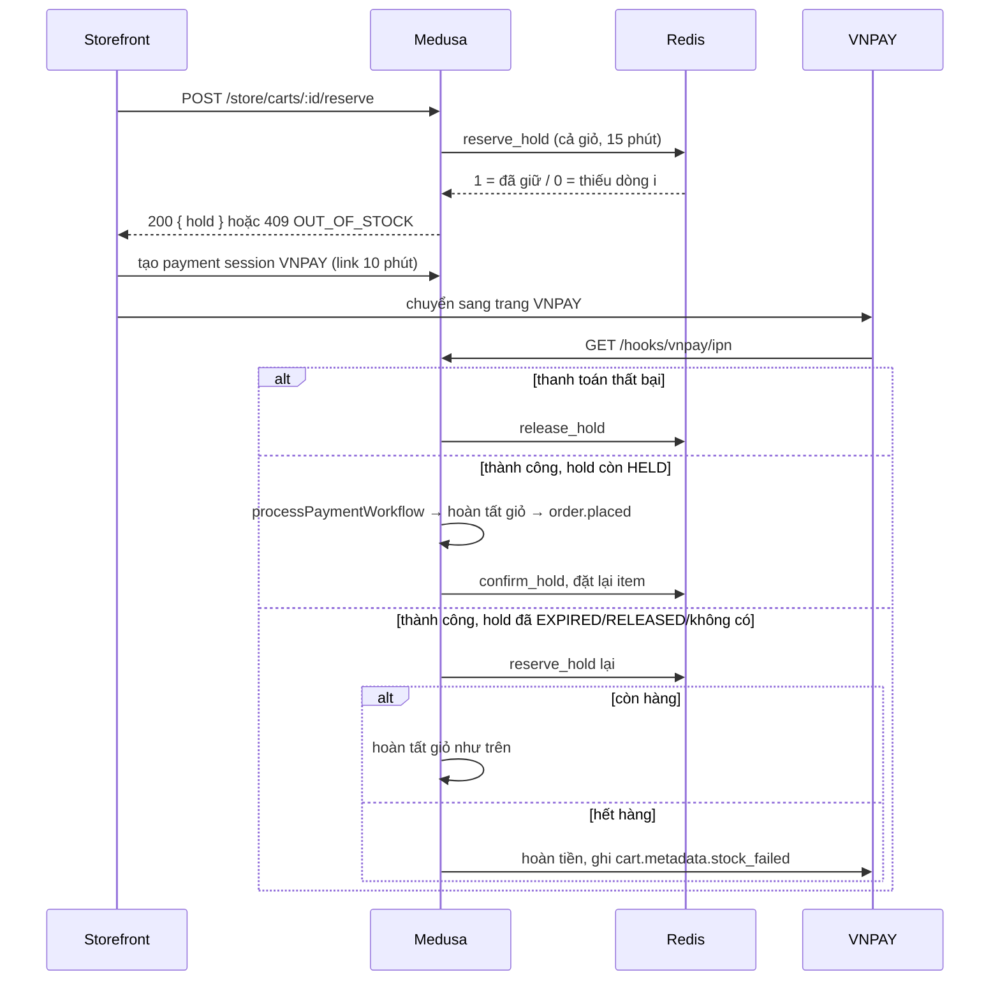

# Redis: Hot-Stock Gate và tồn kho real-time

> **Cho người làm tiếp:** làm lần lượt từng task, tick `- [ ]` khi xong, ghi commit hash vào bảng ở mục 0. Mỗi task chạy được và có test trước khi sang task sau. Quy ước Medusa 2.21.1 ở `AGENTS.md` của repo vẫn ưu tiên: logic nằm trong module/workflow, route chỉ chạy workflow, không raw SQL. **Đừng đoán API Medusa từ trí nhớ**: điểm nào chưa chắc thì kiểm ở HS-0 và ghi vào `docs/contracts/verified-apis.md`.
>
> Nhánh: `feature/medusa-backend-integration` (làm tiếp trên nhánh chung, không tách nhánh riêng). Người làm: noper1080 và Claude.

**Mục tiêu:** đưa phần thí nghiệm của issue #9 (Lua giữ hàng, repo thử `test-medusa-goc`) vào backend thật: nhiều khách cùng mua món cuối thì không bán quá số còn lại, khớp với luồng thanh toán VNPAY đang có; sau đó phát thay đổi tồn kho tới storefront qua Socket.io.

**Không thuộc plan này:** Buy It Again dùng Redis (module AI #1), Docker Compose (issue #6), đấu trang thanh toán FE (đợt 4, chỉ chốt hợp đồng ở đây).

## 0. Bảng trạng thái

| Task | Nội dung | Phụ thuộc | Trạng thái |
| :--- | :--- | :--- | :--- |
| HS-0 | Spike: kiểm các hành vi Medusa mà plan dựa vào | | [ ] |
| HS-1 | Redis, `ioredis`, khung module `hot-stock` | HS-0 | [ ] |
| HS-2 | Chuyển 3 script Lua vào module, sửa lỗi, test jest | HS-1 | [ ] |
| HS-3 | Bản sao tồn kho trong Redis: dựng từ Postgres, đồng bộ, đối soát | HS-2 | [ ] |
| HS-4 | Workflow và route giữ hàng (API-14) | HS-3 | [ ] |
| HS-5 | Vòng đời hold: xác nhận khi có đơn, hết hạn | HS-4 | [ ] |
| HS-6 | VNPAY: link 10 phút, nhả khi thất bại, lưới an toàn khi IPN tới muộn | HS-5 | [ ] |
| HS-7 | Thí nghiệm H4, đo P95, dàn ý `docs/hot-stock.md` | HS-6 | [ ] |
| HS-8 | Pub/Sub → Socket.io gateway và `GET /store/stock` | HS-3 | [ ] |
| HS-9 | (Tùy chọn) Module Redis của Medusa: event bus, workflow engine, locking | HS-7 | [ ] |
| HS-10 | Tài liệu: README, `.env.template`, bảng API, nhật ký | tất cả | [ ] |

Ký hiệu như plan `2026-10-18`: `[x]` xong và đã kiểm · `[~]` code và test xong nhưng còn phần kiểm tay · `[ ]` chưa làm.

Thứ tự: phần A (HS-1 → HS-7) trước, phần B (HS-8) sau, HS-9 để cuối và có thể bỏ.

## 1. Đã chốt (thảo luận 2026-11-03)

| # | Quyết định | Lý do |
| :--- | :--- | :--- |
| D1 | **Postgres là nguồn sự thật**, Redis chỉ là cổng chặn trước thanh toán. Redis mất dữ liệu thì dựng lại từ Postgres | Proposal mục 5, rủi ro TR-01 |
| D2 | **Hold 15 phút, link VNPAY 10 phút** (`EXPIRE_MS` trong `modules/vnpay/lib/url.ts` từ 15 xuống 10) | Còn 5 phút dự phòng cho IPN tới chậm |
| D3 | Hold chỉ được nhả khi **hết 15 phút** hoặc **IPN báo thất bại**, không nhả lúc link hết hạn | Link hết hạn chỉ chặn việc bắt đầu trả tiền, IPN vẫn có thể tới sau |
| D0 | VNPAY hiện **chỉ chạy giả lập** (IPN tự ký bằng khóa thử, chưa có tài khoản sandbox thật, 2026-11-03). Test HS-6 dùng IPN giả lập như `vnpay-ipn.spec.ts`; kiểm trên sandbox thật gộp vào BE-5/BE-8 khi có tài khoản | Chưa có `TMN_CODE`/`HASH_SECRET` thật |
| D4 | **IPN thành công mà hold không còn `HELD`** (hết hạn, đã nhả, hoặc khách chưa từng giữ): chạy lại script giữ hàng ngay. Còn hàng thì hoàn tất giỏ, hết hàng thì **hoàn tiền tự động** | Khoảng trống giữa lúc hold hết hạn và lúc IPN tới: người khác có thể đã giữ mất món cuối (ví dụ ở mục 2) |
| D5 | Khoá chống lặp là **`cart_id`** (một giỏ có tối đa một hold). Giữ lại khi giỏ đang `HELD` thì script **cộng trả hold cũ rồi giữ theo giỏ mới, trong cùng một lần chạy**; hold cũ đã `RELEASED`/`EXPIRED` thì tạo hold mới | Bấm 2 lần, khách sửa giỏ, thử trả lại đều đúng. **Khác proposal** (header `Idempotency-Key`, key `idem:*`): ghi lý do trong `docs/hot-stock.md` |
| D6 | Key theo `inventory_item_id` tại kho Kho Q.7 (`stock:avail:{location_id}:{inventory_item_id}`), không theo `variant_id` | Event tồn kho của Medusa gửi theo inventory item và inventory level; proposal Table 3.1 |
| D7 | Module `hot-stock` có **một kết nối `ioredis` riêng**; không bật `projectConfig.redisUrl` | `redisUrl` chuyển phiên đăng nhập sang Redis, không cần cho việc giữ hàng |
| D8 | Redis là **bắt buộc** khi chạy backend (thiếu thì báo lỗi lúc khởi động) | Ít nhánh code hơn cờ bật/tắt; README hướng dẫn `docker run` |
| D9 | Gateway real-time là **process riêng** `apps/realtime-gateway` (cổng 4001), phát `{ variant_id, available }`; FE tự đổi sang nhãn "Còn N", "Hết hàng" bằng `stockLabel(qty, lowStock)` có sẵn | Lua không phải biết ngưỡng `low_stock`. **Khác proposal** (3 event `STOCK_LOW`, `STOCK_DEPLETED`, `STOCK_RESTORED` do server tính) |

## 2. Thiết kế

### 2.1 Key Redis (prefix mặc định `c4f:`)

| Key | Kiểu | Nội dung |
| :--- | :--- | :--- |
| `stock:avail:{loc}:{item}` | String int | Số còn giữ được: `stocked − reserved (Medusa) − held` |
| `stock:held:{loc}:{item}` | String int | Tổng số lượng các hold đang `HELD` của item. Lua tăng khi giữ, giảm khi nhả/xác nhận |
| `stock:variant:{loc}:{item}` | String | `variant_id` của item, để Lua publish đúng biến thể (HS-8) |
| `hold:{cart_id}` | Hash | `{stockKey} → qty` cho mỗi dòng, cộng `__status` (`HELD`/`CONFIRMED`/`RELEASED`/`EXPIRED`), `__exp`, `__attempt` |
| `hold:expiry` | ZSET | `cart_id`, score là thời điểm hết hạn (ms) |
| `channel:inventory_events` | Pub/Sub | `{ variant_id, inventory_item_id, available }` (HS-8) |

Bất biến (Eq. 3.9): `avail ≥ 0` và `avail + held = stocked − reserved` sau mỗi lần đồng bộ.

### 2.2 Đồng bộ với Postgres

- **Đặt lại một item** (script `sync_item.lua`): `SET avail = pgAvail − GET held`, chạy nguyên tử, nên một lần giữ hàng chen vào giữa không làm lệch số. `pgAvail = stocked − reserved` của inventory level tại Kho Q.7.
- **Khi nào đặt lại:** event `inventory-level.*` và `reservation-item.*` (admin nhập kho, hoàn tất giỏ tạo reservation, hủy đơn xoá reservation); sau khi xác nhận hold; job đối soát 15 phút; script dựng lại toàn bộ.
- **Lệch về phía an toàn:** giữa lúc Medusa tạo reservation và lúc subscriber xác nhận hold, item bị trừ hai lần (cả `reserved` lẫn `held`), nên `avail` nhỏ hơn thực tế. Không bao giờ lớn hơn, nên không bán lố; xác nhận xong thì đặt lại.
- **Redis trống (khởi động lạnh):** script giữ hàng trả `-1` (key chưa có), workflow dựng lại các item của giỏ từ Postgres rồi thử lại **một lần**. Không cần hook lúc server khởi động.

### 2.3 Luồng thanh toán



Ví dụ cho nhánh cuối (kho còn 1 hộp dâu): A giữ ở 0:00, trả tiền ở 9:58, ngân hàng chậm; 15:00 hold của A hết hạn và hộp dâu về kho; 15:30 B giữ được; 17:00 IPN của A tới, giữ lại thất bại, nên hoàn tiền cho A.

### 2.4 Cấu trúc code

```text
apps/backend/src/modules/hot-stock/
  index.ts, service.ts          HotStockModuleService: reserve, release, confirm, expireDue, syncItems
  lua/*.lua                     reserve_hold, release_hold, confirm_hold, sync_item
  lib/keys.ts                   dựng tên key (hàm thuần, có unit test)
apps/backend/src/workflows/
  reserve-cart-stock.ts         đọc giỏ → gộp dòng → giữ hàng; compensation: release
  guard-paid-cart-stock.ts      dùng trong IPN (D4)
  sync-hot-stock.ts             đặt lại item từ Postgres
apps/backend/src/api/store/carts/[id]/reserve/route.ts
apps/backend/src/api/store/stock/route.ts                   (HS-8)
apps/backend/src/subscribers/hot-stock-sync.ts, hot-stock-confirm.ts
apps/backend/src/jobs/expire-holds.ts (mỗi phút), reconcile-hot-stock.ts (15 phút)
apps/backend/src/scripts/rebuild-hot-stock.ts
apps/realtime-gateway/                                     (HS-8)
```

## 3. Hợp đồng API mới (bổ sung mục 3 của plan `2026-10-18`)

| # | Endpoint | Hành vi |
| :--- | :--- | :--- |
| API-14 | `POST /store/carts/:id/reserve` | Gọi **trước** khi tạo payment session VNPAY. Body rỗng. `200 { hold: { cart_id, status: "HELD", expires_at } }`; `409 { code: "OUT_OF_STOCK", items: [{ variant_id, requested, available }] }` (không giữ món nào); `409 { code: "CART_COMPLETED" }`; `404` giỏ lạ; `400` giỏ trống. Gọi lại an toàn (D5): giỏ đổi thì giữ theo giỏ mới, hạn được tính lại. **FE:** chèn vào `startPayment` (`src/lib/data/checkout.ts`) sau `addShippingMethod`, trước `initiatePaymentSession`; hiện FE coi mọi `409` là "khung giờ vừa đóng" nên phải phân biệt theo `code` (`SLOT_UNAVAILABLE` / `OUT_OF_STOCK`) |
| API-15 | `GET /store/stock?variant_ids=a,b` | `{ stock: [{ variant_id, available }] }` đọc từ Redis (đã trừ phần đang giữ). Tối đa 100 id. FE dùng làm giá trị đầu và khi kết nối lại socket |
| API-16 | Socket.io `ws://localhost:4001` | Client `emit("subscribe", { variant_ids })` (tối đa 100), nhận `stock:update { variant_id, available }`. Pub/Sub không lưu tin: kết nối lại thì gọi API-15 |
| API-12 (đổi) | `GET /hooks/vnpay/ipn` | Thêm hành vi: thất bại thì nhả hold; thành công mà hết hàng thì hoàn tiền và **không tạo đơn**, `cart.metadata.stock_failed = { at, items }`; vẫn trả `RspCode 00` |

Những API khác (API-1 đến 13) không đổi. `inventory_quantity` trong Store API vẫn là số của Medusa (chưa trừ phần đang giữ).

## 4. Câu hỏi mở

- **O1:** Có chặn tạo payment session khi giỏ chưa giữ hàng không? Hiện **không**: nhánh D4 của IPN đã xử lý trường hợp khách bỏ qua API-14. Chặn thêm thì phải sửa route Medusa có sẵn, nên chỉ làm nếu thầy hỏi.
- **O2:** Hoàn tiền khi IPN hết hàng (D4) dùng `refund-client.ts` của BE-8, và chưa kiểm được trên sandbox (giống BE-8). Gọi API hoàn tiền thất bại thì ghi `stock_failed.refund = "failed"` để Admin xử lý tay.
- **O3:** HS-9 bật event bus Redis thì mọi subscriber (BE-3, BE-6, IPN) chạy qua hàng đợi. Chỉ làm nếu còn thời gian và chạy lại toàn bộ test.

---

## Task HS-0: Spike các hành vi Medusa

**Xong khi:** mỗi câu dưới đây có câu trả lời đã chạy thật, ghi vào `verified-apis.md` mục HS-0. Câu nào khác giả định thì sửa thiết kế ở mục 2 trước khi làm tiếp.

- [ ] Payload của `inventory-level.created/updated/deleted` và `reservation-item.created/updated/deleted` (chỉ có `id`? đọc lại được bản ghi đã xoá không?). Hủy đơn (`cancelOrderWorkflow`, BE-8) và hoàn tất giỏ có phát các event này không.
- [ ] Hoàn tất giỏ tạo reservation trước hay sau `order.placed`; `order.placed` có `data.id` là order id. Tra cart từ order qua link `order_cart` bằng `query.graph`.
- [ ] Biến thể → `inventory_items[].inventory_item_id`, `required_quantity` (catalog hiện có 1 item mỗi biến thể; vẫn nhân `required_quantity`).
- [ ] Tạo payment session mới cho giỏ đã có session VNPAY thì session cũ bị xoá hay giữ (ảnh hưởng IPN tìm phiên).
- [ ] Hoàn tất giỏ thiếu hàng trong Postgres thì `processPaymentWorkflow` báo lỗi gì và để lại trạng thái gì.
- [ ] Module tự viết nhận `options` từ `medusa-config.ts` và dọn kết nối khi tắt (`__hooks.onApplicationShutdown` hoặc tương đương 2.21.1); cấu hình scheduled job (`config.schedule`).

## Task HS-1: Redis, `ioredis`, khung module

**Files:** `apps/backend/package.json`, `medusa-config.ts`, `src/modules/hot-stock/{index,service}.ts`, `.env.template`, `.env.test.template`, README (mục Getting started).

**Xong khi:** `npm run backend:dev` có Redis thì khởi động bình thường, không có thì báo lỗi rõ (D8); test kiểm `service.ping()`.

- [ ] Container: `docker run -d --name com4fud-redis -p 6379:6379 -v com4fud-redisdata:/data --restart unless-stopped redis/redis-stack-server:7.2.0-v10` với AOF (`REDIS_ARGS="--appendonly yes"`). Kiểm tag có thật trước khi ghi vào README.
- [ ] `npx npm@10.9.8 install ioredis@5.11.1 --workspace=@dtc/backend` (cùng bản Medusa đang dùng; **không** dùng `^6.0.0` của repo thử).
- [ ] Đăng ký module `./src/modules/hot-stock` với options `{ redisUrl, prefix, holdTtlSeconds: 900, locationName: "Kho Q.7" }`; test dùng prefix riêng và xoá key theo prefix sau mỗi suite.
- [ ] Commit `feat(hot-stock): redis connection and module skeleton`.

## Task HS-2: Script Lua

**Files:** `src/modules/hot-stock/lua/*.lua`, `service.ts`, `lib/keys.ts`, `src/modules/hot-stock/__tests__/*.spec.ts`.

**Xong khi:** các test của repo thử (bước 1–3) chạy bằng jest trên Redis thật, cộng các ca mới dưới đây.

- [ ] Chuyển `reserve_hold`, `release_hold`, `confirm_hold` từ `test-medusa-goc/apps/backend/src/redis-hold/lua`; giữ comment, giữ quy ước mã trả về (`1`, `0`, `-1`, `-2`, `-3`).
- [ ] **Sửa 1 (D5):** hold đang `HELD` thì cộng trả rồi giữ lại theo giỏ mới; hold `RELEASED`/`EXPIRED` thì ghi đè; `CONFIRMED` trả `3`.
- [ ] **Sửa 2:** `release_hold` nhận đủ key qua `KEYS` (không lấy tên key từ field rồi ghi), đúng quy tắc khai báo key của Redis.
- [ ] Thêm bộ đếm `stock:held:*` trong cả 3 script; thêm `sync_item.lua` (mục 2.2).
- [ ] Service nạp script một lần bằng `defineCommand`, đọc file `.lua` bằng `readFileSync` theo `__dirname`. Kiểm `medusa build` có chép file `.lua` vào `.medusa/server` không; không thì nhúng nội dung script vào file `.ts`.
- [ ] Test: 100 lần giữ đồng thời tranh 5 món × 20 lượt (đúng 5 thành công, `avail ≥ 0`); giỏ nhiều món tất cả hoặc không; giữ lại sau `EXPIRED` thì trừ lại thật; giữ lại khi giỏ đổi số lượng; confirm và release chạy đua; `expireDue` song song; `sync_item` chen giữa các lần giữ.
- [ ] Commit `feat(hot-stock): atomic hold scripts ported from issue #9`.

## Task HS-3: Bản sao tồn kho

**Files:** `src/workflows/sync-hot-stock.ts`, `src/subscribers/hot-stock-sync.ts`, `src/jobs/reconcile-hot-stock.ts`, `src/scripts/rebuild-hot-stock.ts`, `src/lib/seed` (gọi dựng lại sau seed).

**Xong khi:** sau seed, mọi item có key đúng `stocked − reserved`; admin sửa tồn trong Admin thì key đổi trong vài giây; hủy đơn thì key tăng lại; test đối chiếu Redis với Postgres.

- [ ] Workflow `sync-hot-stock` nhận `inventory_item_ids` (hoặc rỗng = toàn bộ), đọc inventory level tại Kho Q.7 bằng `query.graph`, chạy `sync_item` theo lô.
- [ ] Subscriber cho các event đã kiểm ở HS-0. Event không đọc được item (bản ghi đã xoá) thì đặt lại toàn bộ.
- [ ] Job đối soát 15 phút; ghi log số item lệch (bằng chứng cho báo cáo về TR-01).
- [ ] Script `npx medusa exec ./src/scripts/rebuild-hot-stock.ts`; seed gọi cuối cùng.
- [ ] Commit `feat(hot-stock): mirror available stock from postgres`.

## Task HS-4: Giữ hàng (API-14)

**Files:** `src/workflows/reserve-cart-stock.ts`, `src/api/store/carts/[id]/reserve/route.ts`, `src/api/middlewares.ts`, `integration-tests/http/hot-stock-reserve.spec.ts`.

**Xong khi:** các mã trả về của API-14 đúng như mục 3; test http qua route thật với giỏ thật.

- [ ] Workflow: đọc giỏ (`query.graph`, gồm `completed_at`, `items.variant.inventory_items`); gộp các dòng cùng item (repo thử trả `-3` khi trùng); biến thể không quản kho (`manage_inventory = false`) thì bỏ qua; giữ hàng; mã `-1` thì dựng lại item rồi thử lại một lần.
- [ ] Compensation của bước giữ hàng: `release` khi bước sau trong workflow lỗi.
- [ ] Route chỉ chạy workflow, đổi lỗi thành 409 có `items` (ánh xạ inventory item về `variant_id`).
- [ ] Test: đủ hàng; thiếu một món thì không giữ món nào; giỏ đã hoàn tất; gọi 2 lần; đổi số lượng rồi gọi lại; Redis trống thì vẫn giữ được.
- [ ] Commit `feat(hot-stock): reserve cart stock before payment`.

## Task HS-5: Xác nhận và hết hạn

**Files:** `src/subscribers/hot-stock-confirm.ts`, `src/jobs/expire-holds.ts`, test http.

**Xong khi:** đặt đơn xong thì hold thành `CONFIRMED` và key khớp Postgres; hold quá 15 phút thì `EXPIRED` và hàng trả về; hủy đơn đã xác nhận thì key tăng lại qua HS-3 (không gọi `release`, vì hold đã `CONFIRMED`).

- [ ] Subscriber `order.placed`: tra cart qua `order_cart` (sửa lỗi lấy order id làm cart id của repo thử) → `confirm` → đặt lại các item của đơn.
- [ ] Job mỗi phút gọi `expireDue` (tối đa 200 hold một lần, như repo thử).
- [ ] Test: hoàn tất giỏ đã giữ rồi kiểm key; giả lập hết hạn (gọi `expireDue` với `now` tương lai).
- [ ] Commit `feat(hot-stock): confirm holds on order placed, expire stale holds`.

## Task HS-6: VNPAY

**Files:** `src/modules/vnpay/lib/url.ts`, `src/api/hooks/vnpay/ipn/route.ts`, `src/workflows/guard-paid-cart-stock.ts`, `integration-tests/http/vnpay-ipn.spec.ts`.

**Xong khi:** các ca của API-12 (đổi) có test; test IPN cũ vẫn qua.

- [ ] `EXPIRE_MS` 10 phút (D2); sửa test của `url.ts`.
- [ ] Bước 5 của IPN (thanh toán không thành công): nhả hold của giỏ, vẫn trả `00`.
- [ ] Bước 6 (thành công), trước khi phát event: workflow `guard-paid-cart-stock` (D4). Hết hàng thì hoàn tiền bằng `refund-client.ts` theo `vnp_transaction_no`, ghi `cart.metadata.stock_failed`, không phát event. IPN gửi lại thì đọc `stock_failed` và trả `02`.
- [ ] Test: thất bại thì nhả; thành công khi `HELD`; thành công sau khi hết hạn mà còn hàng; thành công sau khi hết hạn mà hết hàng (mock refund client) thì không có đơn; IPN gửi lặp.
- [ ] Ghi chú trong `verified-apis.md`: phần hoàn tiền chung trạng thái "chưa kiểm sandbox" với BE-8.
- [ ] Commit `feat(vnpay): hold-aware IPN and 10 minute payment link`.

## Task HS-7: Thí nghiệm và tài liệu cho báo cáo

**Files:** `integration-tests/http/hot-stock-h4.spec.ts`, `tools/bench/hot-stock-bench.ts`, `docs/hot-stock.md`.

**Xong khi:** có số đo thật kèm môi trường đo; `docs/hot-stock.md` có dàn ý và sơ đồ. **Phần văn xuôi do hai người làm issue #9 (noper1080, Thiện) tự viết lại** (yêu cầu AI score < 10%).

- [ ] H4 qua HTTP: N = 100 lần gọi API-14 đồng thời, S0 = 5, lặp 20 lần; thêm các kịch bản thanh toán lỗi, gọi lặp, hết hạn hold. Ghi số thành công và `avail` nhỏ nhất.
- [ ] Đo P95 của `reserve_hold` (gọi trực tiếp và qua HTTP), so với bản GET/DECRBY không nguyên tử của repo thử (số lần bán lố). Ghi máy, số lần lặp, cách tính P95. Đây là số đo được, không phải số mục tiêu của proposal.
- [ ] Dàn ý `docs/hot-stock.md`: vấn đề, vì sao cần thao tác nguyên tử, các script, vòng đời hold, đồng bộ Postgres, luồng VNPAY (sơ đồ 2.3), các chỗ khác proposal (D5, D9), các tình huống lệch dữ liệu (tiêu chí của issue #9).
- [ ] Commit `test(hot-stock): H4 concurrency experiment and latency benchmark`.

## Task HS-8: Pub/Sub → Socket.io

**Files:** các script Lua (thêm `PUBLISH`), `src/api/store/stock/route.ts`, `apps/realtime-gateway/{package.json,src/index.ts}`, root `package.json` (script `gateway:dev`).

**Xong khi:** mở hai trình duyệt nhỏ (script test socket), một bên giữ hàng thì bên kia nhận `stock:update` với số mới; API-15 trả đúng số trong Redis.

- [ ] Lua `PUBLISH channel:inventory_events` sau mỗi lần `avail` đổi (giữ, nhả, hết hạn, đặt lại). Đặt `stock:variant:*` trong `sync_item`.
- [ ] API-15 (route chỉ chạy workflow đọc Redis, kiểm `variant_ids` bằng zod).
- [ ] Gateway: `ioredis` subscriber + `socket.io` server cổng 4001, CORS lấy `STORE_CORS`, room `variant:{id}`, giới hạn 100 id mỗi lần subscribe. Ghim version `socket.io`.
- [ ] Test: unit cho việc đổi tin nhắn Redis sang room; test tích hợp bằng `socket.io-client`.
- [ ] Ghi hợp đồng API-15, API-16 cho FE (cài `socket.io-client`, biến `NEXT_PUBLIC_REALTIME_URL`, `LiveStock` nhận số mới).
- [ ] Commit `feat(realtime): stock updates over socket.io`.

## Task HS-9 (tùy chọn): Module Redis của Medusa

- [ ] Bật `@medusajs/medusa/event-bus-redis`, `workflow-engine-redis`, `locking` với provider `locking-redis` (đã có trong `node_modules`, tra docs 2.21.1 trước).
- [ ] Chạy lại toàn bộ test unit và integration; kiểm subscriber BE-3, BE-6, IPN vẫn chạy (event bus Redis chạy bất đồng bộ qua hàng đợi).
- [ ] Không qua được thì ghi lại lý do và bỏ, không chặn các task khác.

## Task HS-10: Tài liệu

- [ ] README: container Redis, biến môi trường, `rebuild-hot-stock`, gateway; nói rõ teammate làm FE cần chạy thêm container Redis.
- [ ] `.env.template`: bỏ dòng "Not used yet" của `REDIS_URL`, thêm `HOT_STOCK_PREFIX`, `REALTIME_PORT`.
- [ ] Bảng API mục 3 của plan `2026-10-18`: thêm API-14 đến 16, sửa API-12.
- [ ] `verified-apis.md` mục HS-x; nhật ký tiến độ ngoài repo.
- [ ] Commit `docs: hot-stock and realtime setup`.
